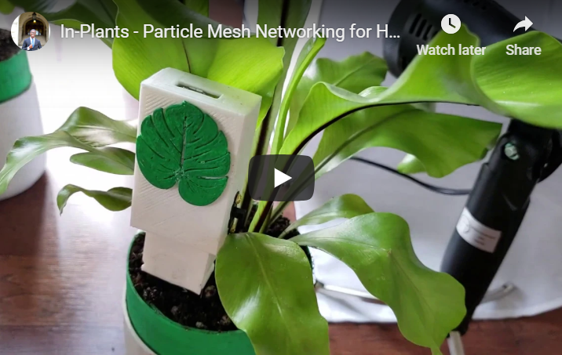

# In-Plants

🌱🌱🌱

An IoT device used to check the humidity levels of your houseplants. Low powered, rechargeable, and powered by Particle's Mesh devices.

[](https://youtu.be/zaqqBVdNWlM)

- ***NEW***: [Magic Mirror Module](https://github.com/NickEngmann/MMM-ParticleStatus)


- [Instructions](https://github.com/NickEngmann/in-plants)

- [Youtube Demo](https://youtu.be/zaqqBVdNWlM)

- [Enclosure](https://www.thingiverse.com/thing:3437707)

🌱🌱🌱

---

## Overview

In-Plants is an IoT firmware project for Particle Mesh devices (Argon/Xenon) that monitors houseplant humidity using capacitive moisture sensors. The firmware publishes sensor readings to the Particle cloud every 30 seconds (or longer intervals when sleeping). The Xenon variant includes wireless charging support and battery monitoring with sleep functionality to conserve power.

### Key Features

- **Real-time humidity monitoring** for houseplants using capacitive sensors
- **Particle Mesh integration** for cloud connectivity and remote monitoring
- **Two firmware variants**:
  - **Argon variant** (`inplants-argon.ino`): Always-on operation with 30-second publish intervals
  - **Xenon variant** (`inplants-xenon.ino`): Sleep-capable with battery monitoring and wireless charging support
- **Cloud publishing** of moisture percentage, analog readings, and voltage data
- **Low power design** optimized for battery operation (Xenon variant)

### Published Events

The firmware publishes the following events to the Particle cloud:

- `plantStatus_analog` - Raw analog sensor reading (0-4095)
- `plantStatus_percentage` - Calculated moisture percentage (0-100%)
- `plantStatus_voltage` - Battery voltage reading (Xenon variant only)

---

## Hardware Requirements

### Required Components

- **Particle Argon** or **Particle Xenon** development board
- **Capacitive moisture sensor** (recommended over resistive for longevity)
- **Jumper wires** (female-to-female and male-to-female)
- **Breadboard** (optional, for prototyping)
- **Micro USB cable** (for initial flashing and power)
- **3.7V LiPo battery** (for Xenon variant battery operation)
- **Wireless charging coil** (optional, for Xenon variant wireless charging)

### Pin Connections

#### Argon Variant (Always-On)

| Component | Particle Argon Pin |
|-----------|-------------------|
| Moisture Sensor Signal | A1 |
| Moisture Sensor VCC | 3V3 |
| Moisture Sensor GND | GND |
| Status LED | D7 (built-in) |

#### Xenon Variant (Sleep-Capable)

| Component | Particle Xenon Pin |
|-----------|-------------------|
| Moisture Sensor Signal | A1 |
| Moisture Sensor VCC | 3V3 |
| Moisture Sensor GND | GND |
| Wake-up Button | D1 |
| Battery Monitor | BATT |
| Status LED | D7 (built-in) |

---

## Installation

### Prerequisites

1. **Particle CLI** installed on your development machine
   - Install via npm: `npm install -g particle-cli`
   - Or download from [Particle's website](https://www.particle.io/products/cli)

2. **Arduino IDE** (optional, for alternative flashing method)
   - Download from [Arduino's website](https://www.arduino.cc/en/software)
   - Install Particle board support via Board Manager

3. **Particle Account**
   - Create an account at [particle.io](https://particle.io)
   - Register your device in the Particle Dashboard

### Flashing Firmware

#### Method 1: Using Particle CLI (Recommended)

1. **Connect your device** via USB to your computer

2. **Compile and flash the Argon variant**:
   ```bash
   particle compile argon inplants-argon.ino --target 10.2.0
   particle flash argon inplants-argon.ino.bin
   ```

3. **Compile and flash the Xenon variant**:
   ```bash
   particle compile xenon inplants-xenon.ino --target 10.2.0
   particle flash xenon inplants-xenon.ino.bin
   ```

#### Method 2: Using Arduino IDE

1. **Install Particle plugin** for Arduino IDE
   - Go to File > Preferences > Additional Board Manager URLs
   - Add: `https://downloads.particle.io/sdk/arduino/package_particle_index.json`
   - Go to Tools > Board > Board Manager
   - Search for "Particle" and install

2. **Select your board**:
   - For Argon: Tools > Board > Particle Argon
   - For Xenon: Tools > Board > Particle Xenon

3. **Open the firmware file**:
   - File > Open > `inplants-argon.ino` or `inplants-xenon.ino`

4. **Upload**:
   - Click the Upload button (right arrow icon)

### Pre-built Firmware

Pre-compiled firmware binaries are available in the `firmware/` directory:

- `inplants-argon.bin` - Argon variant firmware
- `inplants-xenon.bin` - Xenon variant firmware

You can flash these directly using Particle CLI:
```bash
particle flash argon firmware/inplants-argon.bin
particle flash xenon firmware/inplants-xenon.bin
```

---

## Usage

### Device Setup

1. **Connect your moisture sensor** to the appropriate pins (see Hardware Requirements)

2. **Flash the firmware** to your device using one of the methods above

3. **Verify device registration** in the Particle Dashboard:
   - Go to https://dashboard.particle.io
   - Select your device
   - Verify it shows as "Connected"

4. **Monitor sensor readings**:
   - View real-time data in the Particle Dashboard
   - Subscribe to events using the Particle CLI:
     ```bash
     particle events your-device-name
     ```

### Operating Modes

#### Argon Variant (Always-On)

- **Publish interval**: Every 30 seconds
- **Power consumption**: Higher (always active)
- **Best for**: Plants requiring frequent monitoring, AC-powered setups

#### Xenon Variant (Sleep-Capable)

- **Publish interval**: Every 30 minutes (default)
- **Power consumption**: Low (sleeps between measurements)
- **Wake-up methods**:
  - **Timer-based**: Automatically wakes every 30 minutes
  - **Button press**: Press D1 pin to wake immediately
- **Best for**: Battery-powered setups, plants requiring less frequent monitoring

### Sensor Calibration

The moisture percentage is calculated based on sensor readings. You may need to calibrate for your specific setup:

1. **Find dry reading** (sensor in air):
   ```cpp
   int dryReading = analogRead(A1);
   ```

2. **Find wet reading** (sensor in water):
   ```cpp
   int wetReading = analogRead(A1);
   ```

3. **Adjust calibration constants** in the firmware:
   ```cpp
   #define MOISTURE_DRY 2048  // Adjust based on your sensor
   #define MOISTURE_WET 1024  // Adjust based on your sensor
   ```

---

## Testing

### Hardware Testing

Since this is embedded firmware, testing requires physical hardware:

1. **Verify sensor connections**:
   - Check that moisture sensor is properly connected to A1
   - Ensure VCC and GND are connected correctly
   - Verify LED on D7 is visible

2. **Test Argon variant**:
   - Flash firmware to Argon board
   - Verify device connects to Particle cloud
   - Monitor `plantStatus_analog` and `plantStatus_percentage` events
   - Check that readings change when sensor is exposed to different moisture levels

3. **Test Xenon variant**:
   - Flash firmware to Xenon board
   - Verify device connects to Particle cloud
   - Monitor all events including `plantStatus_voltage`
   - Test sleep functionality by checking power consumption
   - Verify wake-up button on D1 works correctly
   - Test battery monitoring with connected power source

### Known Testing Limitations

- **No automated test framework**: Firmware requires physical Particle hardware
- **Cannot test in container**: Requires actual Argon/Xenon boards
- **Sensor variability**: Readings may vary based on soil composition and sensor placement
- **Power management**: Xenon sleep functionality requires careful testing with actual battery

---

## Troubleshooting

### Common Issues

#### Device Not Connecting to Cloud

- **Check**: Device LED color (solid blue = connected, flashing blue = connecting)
- **Solution**: Restart device, check WiFi network, verify device is registered in Particle Dashboard

#### Inconsistent Sensor Readings

- **Check**: Sensor placement in soil, soil composition, sensor calibration
- **Solution**: Recalibrate sensor, ensure consistent placement, verify sensor is not damaged

#### Xenon Not Sleeping Properly

- **Check**: Battery connections, wake-up button wiring, firmware configuration
- **Solution**: Verify BATT pin connections, test wake-up button, check sleep interval settings

#### Low Battery Voltage Readings

- **Check**: Battery health, charging circuit (if applicable), voltage divider resistors
- **Solution**: Replace battery, verify charging circuit, check voltage divider values

### Debugging Tips

1. **Enable verbose logging** in firmware (uncomment debug statements)
2. **Monitor serial output** via USB connection
3. **Check Particle Dashboard** for event history and device status
4. **Use Particle CLI** for detailed device information:
   ```bash
   particle status your-device-name
   particle logs your-device-name
   ```

---

## Architecture

### Firmware Structure

```
in-plants/
├── inplants-argon.ino    # Always-on Argon variant
├── inplants-xenon.ino    # Sleep-capable Xenon variant
├── firmware/             # Pre-built firmware binaries
│   ├── inplants-argon.bin
│   └── inplants-xenon.bin
├── schematics/           # Circuit diagrams
└── imgs/                 # Photos and diagrams
```

### Data Flow

1. **Sensor Reading**: Capacitive moisture sensor connected to A1 pin
2. **Analog Conversion**: Particle ADC converts analog signal to digital value (0-4095)
3. **Calibration**: Raw value mapped to moisture percentage (0-100%)
4. **Publishing**: Data published to Particle cloud via `Particle.publish()`
5. **Sleep** (Xenon only): Device enters deep sleep between measurements
6. **Wake-up** (Xenon only): Timer or button press wakes device

### Power Management (Xenon Variant)

- **Active mode**: Full power for sensor reading and cloud communication
- **Sleep mode**: Ultra-low power consumption (~20µA)
- **Wake-up sources**:
  - **RTC timer**: Automatically wakes every 30 minutes
  - **External button**: Press D1 pin to wake immediately
- **Battery monitoring**: Continuous voltage monitoring during active mode

---

## Contributing

### Adding New Features

1. **Fork the repository**
2. **Create a feature branch**
3. **Test on physical hardware** (required for all changes)
4. **Submit a pull request** with detailed testing notes

### Code Style

- Follow Arduino/C++ conventions
- Include comments for complex logic
- Document new features and their hardware requirements
- Test thoroughly before submitting

---

## License

This project is open source. Feel free to use, modify, and distribute for your own projects.

---

## Credits

- **Particle Mesh platform** for cloud connectivity
- **Capacitive moisture sensors** for reliable plant monitoring
- **Arduino framework** for embedded development
- **Community contributors** for feedback and improvements

---

## Additional Resources

- [Particle Documentation](https://docs.particle.io/)
- [Argon Datasheet](https://cdn.particle.io/datasheets/particle-argon-datasheet.pdf)
- [Xenon Datasheet](https://cdn.particle.io/datasheets/particle-xenon-datasheet.pdf)
- [Moisture Sensor Datasheet](https://cdn.particle.io/datasheets/capacitive-moisture-sensor-datasheet.pdf)

🌱🌱🌱
